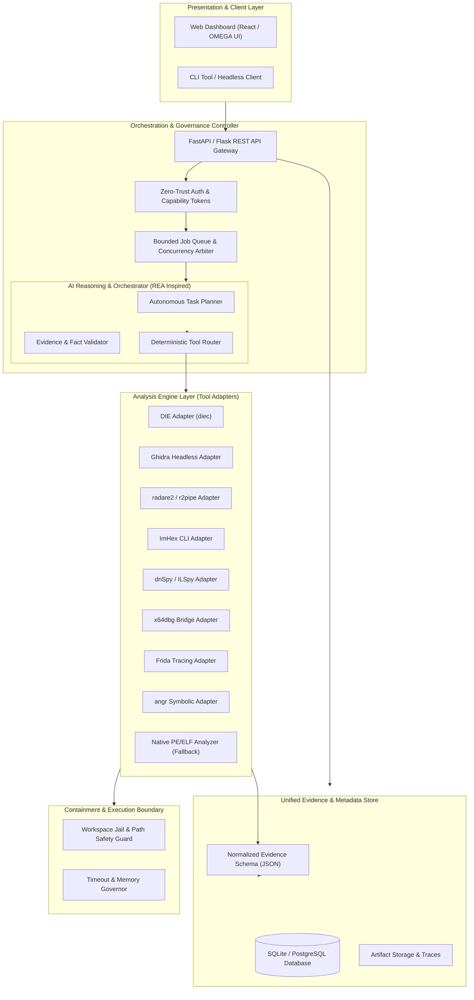

# Unified AI-Powered Reverse Engineering Platform
## Master Technical Architecture & Integration Specification

---

## 1. Verified Compatibility & Integration Matrix (10 Repositories)

| # | Tool / Repository | Primary Role | License | Supported OS & Arch | CLI / Automation Interface | Input Formats | Python / API Integration | Key Prerequisites & Constraints |
|---|---|---|---|---|---|---|---|---|
| **1** | **REA** `morluto/rea` | AI reverse-engineering agent & task planning | MIT | Cross-platform (Python 3.10+) | Python API / CLI / Ghidra extension bridge | Binary representations, disassembly, decompiler output | Python native (`rea` package or embedded module) | Needs LLM endpoint (Ollama / Groq / OpenAI / Gemini). Must be constrained to prevent hallucinations. |
| **2** | **Ghidra** `NationalSecurityAgency/ghidra` | Deep static analysis, decompilation & CFG recovery | Apache 2.0 | Windows, Linux, macOS (x86_64, ARM64) | `analyzeHeadless` batch script runner | PE, ELF, Mach-O, COFF, Raw firmware, 30+ CPU architectures | Subprocess (`analyzeHeadless`), PyGhidra, or Ghidra Bridge | Requires JDK 17 or JDK 21 (64-bit). High memory footprint (min 2–4 GB JVM heap). |
| **3** | **x64dbg** `x64dbg/x64dbg` | Native Windows interactive dynamic debugging | GPLv3 | Windows (x86, x64) only | CLI script engine, command line args, IPC / pipe plugins | 32-bit & 64-bit Windows PE executables/DLLs | Python via `x64dbgpy` or command-script injection | Strictly Windows-only. Cannot debug native Linux/ARM binaries directly without virtualization. |
| **4** | **ImHex** `WerWolv/ImHex` | Hex inspection, custom binary patterns, entropy | GPLv2 | Windows, Linux, macOS | `imhex-cli` (pattern evaluator, data processing) | Any raw binary, ROMs, custom protocols, archives | CLI subprocess execution; `.hexpat` pattern files | Requires modern OpenGL/Vulkan for GUI; `imhex-cli` used for headless extraction. |
| **5** | **dnSpyEx** `dnSpyEx/dnSpy` | .NET assembly decompilation, IL editing, debugging | GPLv3 | Windows (.NET 4.7.2 / .NET 6/8 runtime) | GUI; CLI via ILSpy CLI (`ilspycmd`) or `dnSpy.Console` | .NET Framework, .NET Core, Unity Mono assemblies | Subprocess via `ilspycmd` or custom C# CLI wrapper | Limited to CLI extraction in automated headless pipelines; decompiler engine is ILSpy-derived. |
| **6** | **radare2** `radareorg/radare2` | Fast disassembler, binary metadata, strings, symbols | LGPLv3 / GPLv3 | Linux, Windows, macOS, Android, BSD (x86, ARM, MIPS) | `r2 -qc '...'`, `rabin2 -j`, `rahash2`, `radiff2` | PE, ELF, Mach-O, DEX, Java class, raw binary | Python via `r2pipe` or direct JSON parsing of CLI output | Very lightweight (~30MB), highly portable, fast headless JSON outputs (`~{}` / `j` flags). |
| **7** | **Frida** `frida/frida` | Dynamic binary instrumentation & runtime hooking | wxWindows / LGPL-based | Windows, Linux, macOS, Android, iOS (x86, ARM) | `frida-trace`, `frida-cli`, Python API | Any running process, shared library, native/managed executable | Python native bindings (`import frida`) | Needs process injection privileges (administrator/root or seccomp/ptrace permissions). |
| **8** | **Cutter** `rizinorg/cutter` | Visual RE interface powered by Rizin | GPLv3 | Windows, Linux, macOS | Built on Rizin; headless tasks delegate to `rz-bin`, `rizin` | PE, ELF, Mach-O, raw binaries | Python via `rzpipe` | GUI is Qt-based; automated headless engine should invoke underlying Rizin CLI. |
| **9** | **Detect It Easy (DIE)** `horsicq/Detect-It-Easy` | Packer, compiler, linker, signature, and entropy detection | MIT | Windows, Linux, macOS (x86, x64, ARM) | `diec` / `diec.exe` with `-j` (JSON format output) | PE, ELF, Mach-O, APK, JAR, plain files | Subprocess invocation of `diec -j <target>` | Fast, signature-based, minimal dependencies; ideal initial triaging gate. |
| **10** | **angr** `angr/angr` | Automated symbolic execution, path exploration & CFG | BSD 2-Clause | Linux, Windows, macOS (x86_64, ARM64) | Pure Python API | ELF, PE, Mach-O, raw binaries across multiple architectures | Pure Python package (`import angr`) | CPU & memory intensive. State explosion risks require strict timeout and step bounds. |

---

## 2. Proposed Architecture & System Design

---

## 3. Free Cloud Hosting Evaluation (Official Terms)

| Provider & Tier | Machine Architecture & Compute | Memory & Storage | Network / Public IP | Billing Card & Expiration Policy | Tool Compatibility on Instance | Verdict & Strategic Role |
|---|---|---|---|---|---|---|
| **Oracle Cloud Infrastructure (OCI) Always Free** | **4 OCPUs** Ampere A1 (ARM64 Neoverse-N1) OR **2 x86_64 Micro** (1/8 OCPU each) | **24 GB RAM** (ARM) / 1 GB RAM (x86) 200 GB Block Volume | 10 TB/month outbound bandwidth free; up to 2 ephemeral/reserved IPv4s | Credit card required for identity check at signup. **Permanently free** (no trial expiration). *Warning:* Reclaims idle VMs (<20% CPU/RAM for 7 days). | Ghidra, radare2, DIE, Frida (Linux), and angr run **natively on ARM64**. Windows-only tools (x64dbg, dnSpyEx) **cannot** run directly on ARM64 Linux without virtualization. | **RECOMMENDED CLOUD CONTROLLER**. 24 GB RAM and 4 cores easily accommodate Ghidra headless and angr for non-Windows binaries. |
| **Google Cloud Free Tier (GCP)** | 1 `e2-micro` instance (2 vCPUs burstable, x86_64) | 1 GB RAM 30 GB standard persistent disk | **Only 1 GB/month** worldwide egress free (beyond 1GB incurs charges); Ephemeral IP included | Credit card required for verification. Permanently free while in eligible US regions (`us-central1`, `us-east1`, `us-west1`). | 1 GB RAM is severely insufficient for Ghidra JVM or angr symbolic execution. Crashes via OOM killer. | **NOT RECOMMENDED** for heavy analysis. Viable only as lightweight proxy or documentation mirror. |
| **AWS Free Tier** | 1 `t2.micro` or `t3.micro` (1 vCPU, 1 GB RAM) | 1 GB RAM 30 GB EBS storage | 100 GB/month data transfer | Credit card required. **Expires after 12 months** (not permanently free). | 1 GB RAM causes Ghidra and angr to fail with out-of-memory errors. | **DISQUALIFIED**: Not permanently free. |
| **Local Workstation (Windows 11 / x64)** | Local CPU (multi-core x86_64) | 16–64 GB RAM Local SSD | Localhost / Private LAN | Zero cost, no credit card, no cloud provider account. | **100% compatible** with all 10 tools including x64dbg and dnSpyEx. | **RECOMMENDED ANALYSIS WORKER**. Complete security isolation for untrusted binaries. |

### Distributed Hybrid Deployment Recommendation
1. **Cloud Gateway / Controller**: OCI Always Free ARM64 instance (4 OCPUs, 24 GB RAM, 200 GB disk) runs the web UI, FastAPI controller, database, Ghidra (ARM64), radare2, and angr.
2. **Local Worker Node**: User's local Windows machine acts as the dedicated Windows Worker node for x64dbg, dnSpyEx, and native Windows malware containment.
3. **Standalone Local Mode**: The entire platform runs locally on the user's machine with zero cloud dependencies.
