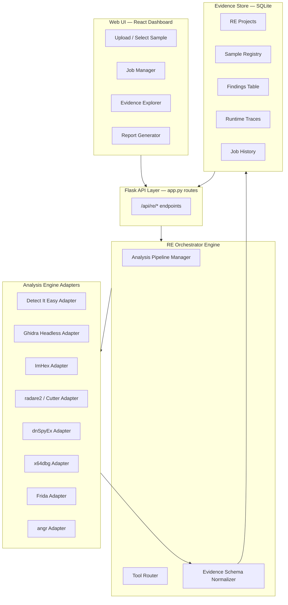

# 🔬 Jarvis RE — Unified Reverse Engineering System

## Implementation Plan

> [!IMPORTANT]
> This system integrates into the existing Jarvis AI codebase (Flask + SQLAlchemy + SQLite) as a new `REVERSE_ENGINEERING/` module, following the established engine pattern used by `core/chat_engine.py`, `core/mission_engine.py`, etc.

---

## Architecture Overview



---

## File Structure

```
c:\AI\jarvis-ai\
├── REVERSE_ENGINEERING/           # New top-level module
│   ├── __init__.py
│   ├── models.py                  # SQLAlchemy models (RE projects, samples, findings, jobs)
│   ├── config.py                  # RE-specific config (tool paths, timeouts, limits)
│   ├── schema.py                  # Evidence schema — Pydantic models for findings
│   ├── pipeline.py                # Analysis pipeline orchestrator
│   ├── routes.py                  # Flask blueprint: /api/re/*
│   ├── utils.py                   # Hashing, arch detection, file identification helpers
│   ├── report_generator.py        # HTML/JSON/Markdown report generation
│   │
│   ├── adapters/                  # Tool adapters — each wraps an external tool
│   │   ├── __init__.py
│   │   ├── base_adapter.py        # Abstract base class for all adapters
│   │   ├── die_adapter.py         # Detect It Easy
│   │   ├── ghidra_adapter.py      # Ghidra headless mode
│   │   ├── imhex_adapter.py       # ImHex CLI
│   │   ├── radare2_adapter.py     # radare2 / rizin
│   │   ├── dnspy_adapter.py       # dnSpyEx (.NET)
│   │   ├── x64dbg_adapter.py      # x64dbg scripting
│   │   ├── frida_adapter.py       # Frida runtime instrumentation
│   │   └── angr_adapter.py        # angr symbolic execution
│   │
│   ├── workspace/                 # Isolated per-sample workspaces (gitignored)
│   │
│   ├── templates/                 # Jinja2 report templates
│   │   ├── report.html
│   │   └── report.md
│   │
│   └── tests/                     # Unit + integration tests
│       ├── __init__.py
│       ├── test_schema.py
│       ├── test_pipeline.py
│       ├── test_adapters.py
│       └── test_samples/          # Benign test binaries
│           └── README.md
```

---

## Phase 01 — Foundation (THIS IMPLEMENTATION)

### Deliverables
- [x] Module structure with `__init__.py` files
- [x] RE-specific SQLAlchemy models
- [x] Evidence schema (Pydantic)
- [x] Config with tool path auto-detection
- [x] Utility functions (SHA-256, architecture detection, file type identification)
- [x] Abstract base adapter class
- [x] Detect It Easy adapter (first real tool integration)
- [x] Analysis pipeline manager
- [x] Flask blueprint with REST API
- [x] Report generator (HTML + JSON + Markdown)
- [x] Registration in main app.py

### Database Models
| Table | Purpose |
|-------|---------|
| `re_projects` | Top-level analysis projects |
| `re_samples` | Uploaded/selected binary files |
| `re_findings` | Normalized findings from all tools |
| `re_jobs` | Analysis job tracking with status |
| `re_runtime_traces` | Dynamic analysis observations (Phase 04) |

### API Endpoints
| Method | Path | Purpose |
|--------|------|---------|
| POST | `/api/re/projects` | Create analysis project |
| GET | `/api/re/projects` | List projects |
| GET | `/api/re/projects/<id>` | Get project details |
| POST | `/api/re/projects/<id>/samples` | Upload/register sample |
| POST | `/api/re/samples/<id>/analyze` | Start analysis job |
| GET | `/api/re/jobs/<id>` | Get job status |
| GET | `/api/re/samples/<id>/findings` | Get findings for sample |
| GET | `/api/re/samples/<id>/report` | Generate report |
| GET | `/api/re/tools/status` | Check available tools |

---

## Phases 02–06 Summary

| Phase | Focus | Key Additions |
|-------|-------|---------------|
| 02 | Static Analysis | Ghidra headless, ImHex, dnSpyEx routing, finding normalization |
| 03 | Cross-Tool Correlation | radare2/Cutter, address mapping, deduplication |
| 04 | Dynamic Analysis | x64dbg, Frida, runtime-to-static correlation |
| 05 | AI Orchestration | AI planner, angr integration, evidence-backed reasoning |
| 06 | Release | Reports, regression tests, metrics, packaging |

---

## Security Boundaries

> [!CAUTION]
> - All samples execute in isolated workspaces under `REVERSE_ENGINEERING/workspace/`
> - Process timeouts enforced on every external tool invocation
> - No network access during analysis by default
> - AI-generated conclusions always tagged `status: "unverified"`
> - API keys never appear in findings or reports
